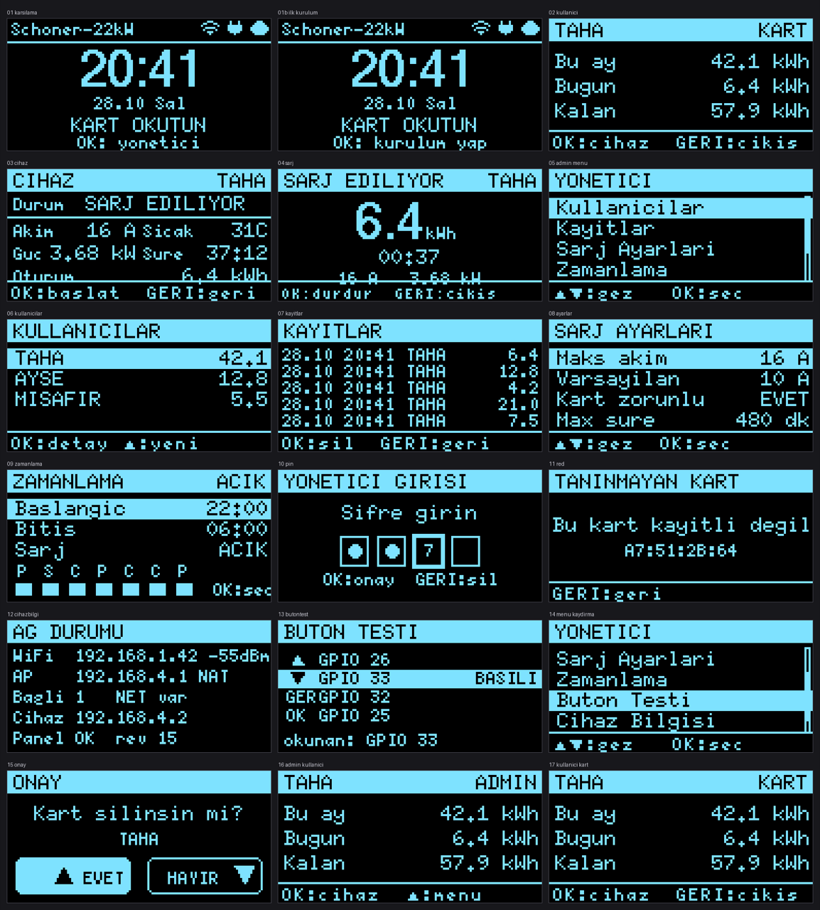
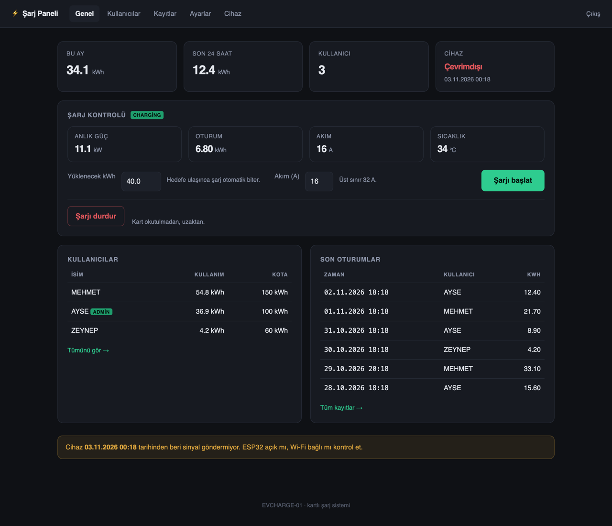
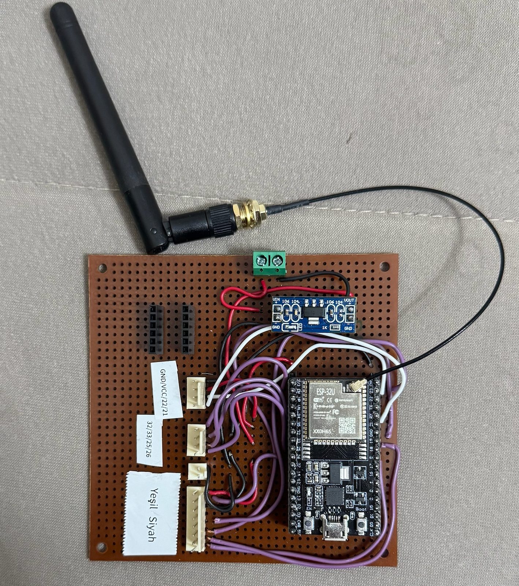
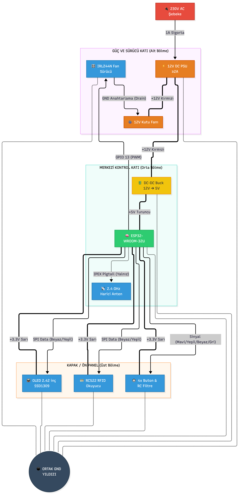

# ESP32 RFID EV Charger

**An off-the-shelf 22 kW AC wallbox turned into an RFID-authorized charging
station with per-user quotas, a cloud admin panel and 24/7 unattended operation.**

`ESP32-WROOM-32U` · `C++17 / PlatformIO` · `Tuya LAN v3.5` · `FastAPI + Postgres`

[](https://github.com/Lenger3/esp32-rfid-ev-charger/actions/workflows/ci.yml)
[](LICENSE)



Everything below the wallbox is built here: the controller PCB, the enclosure,
the firmware, the LAN protocol driver and the admin panel.

---

## Why

A residential 22 kW Tuya wallbox has no notion of *who* is charging. It is one
account, one switch — no quota, no record — which makes it useless on a shared
driveway where the electricity bill has to be split.

The unit is also closed: the vendor app is the only interface and the LAN
protocol is undocumented. Instead of replacing it, I put a controller in front
that owns authorization, metering and audit, while the wallbox keeps its own
safety electronics untouched.

```
                     ┌──────────────┐
┌──────────┐  Wi-Fi  ┌────────┐  TCP 6699   │   Wallbox    │
│  ESP32   │────────►│ Router │◄────────────│  (Tuya LAN)  │
│ + OLED   │         └────────┘  AES-GCM    └──────────────┘
│ + RC522  │              ▲
└────┬─────┘              │  the ESP32 also raises its own AP and NATs
     │ HTTPS (outbound)   │  the wallbox's internet traffic through it
     ▼                    │
┌──────────────┐          │
│  Admin panel │          │
│ FastAPI + PG │          │
│  Caddy + TLS │          │
└──────────────┘          │
   no inbound ports exposed on the internet-facing side
```

---

## Capabilities

| Feature | How |
|---|---|
| RFID authorization | RC522 reads the card UID; the card list is cached in NVS so the device keeps working without a network |
| Per-user quota | Monthly and daily kWh counters in NVS, checked before a session is allowed to start |
| Live charging screen | Big kWh counter, elapsed time, current, power, temperature — Tuya DP pushes plus a 1 s poll |
| Remote control | The panel starts/stops a session and sets the current limit; the device applies the command on its next sync |
| Audit trail | Every session (start, end, kWh, reason code) is written to NVS and pushed to Postgres |
| Offline queue | 32 session records buffered in flash, replayed with an idempotent `client_id` so retries never double-count |
| Watchdog | A separate FreeRTOS task restarts the device on a stalled loop, 10 min without Wi-Fi, or < 15 KB free heap |
| Screen sleep | OLED powers down after 60 s idle; never while charging |
| Anti-free-charging lock | If the wallbox starts on its own (no card), the controller parks it in schedule mode so the relay cannot latch |

---

## How the hard parts work

### 1. Reverse engineering the Tuya LAN protocol

The wallbox speaks Tuya LAN protocol **v3.5** on TCP 6699: 4-byte header, 12-byte
nonce, AES-128-GCM payload, HMAC trailer. The `local_key` behind that cipher
never leaves the vendor cloud, so it is pulled once through the signed cloud API
(`tuya/tuya_cloud.py` — HMAC-SHA256 request signing, stdlib only) and then handed
to the ESP32 **over TLS from the panel**. The device keeps it in RAM only; it is
never written to flash or to a log.

The data-point numbers are not part of the protocol — they have to be discovered.
This map was resolved by diffing the cloud `spec` output against live `status`
frames on the physical unit (`tuya/tuya_local.py identify`):

```
18 switch               bool   charge on/off              [write]
 4 charge_cur_set       int    amps                        [write]
14 work_mode            enum   charge_now / charge_schedule
 3 work_state           enum   charger_free / charging / ...
10 power_total          int    kW x1000
 1 forward_energy_total int    kWh x100   (lifetime)
25 charge_energy_once   int    kWh x100   (this session)
24 temp_current         int    °C
28 charge_time          int    minutes x10
```

Two things cost real time: several large integer DPs arrive **base64-encoded**
instead of plain JSON numbers, and the wallbox pushes unsolicited `0x08` frames —
so the driver keeps a persistent TCP session and polls at 1 Hz, reconnecting only
on failure. Reconnecting per poll was what made the UI lag by seconds.

### 2. Owning the wallbox's network

The controller runs STA + AP at once and enables NAPT, so the wallbox joins
`EVCHARGE-SETUP` and still reaches the vendor cloud through the ESP32:

```
1. STA associates with the router, gets an address
2. softAP comes up                        (needs the STA address)
3. NAPT is enabled                        (fails before step 1)
4. softAP DHCP hands out the upstream DNS (otherwise: "connected, no internet")
```

Step 4 is the one that is easy to miss: NAPT forwards packets but does not answer
DNS, so the AP's DHCP server must advertise an upstream resolver. This needs
`arduino-esp32 >= 3.3.12` (PlatformIO `espressif32@8.0.0`) for
`WiFi.AP.enableNAPT()`; older cores do not compile `CONFIG_LWIP_IPV4_NAPT`.

### 3. Surviving unattended operation

The unit sits powered 24/7 in a garage, so each failure mode is handled
explicitly rather than hoped away:

- **Wi-Fi loss** — exponential backoff (5, 10, then 20/30/60 s), radio reset every
  5th attempt, NAPT and DHCP DNS refreshed on reconnect, reboot after 10 minutes.
- **Wallbox unresponsive** — backoff 5→60 s between polls; 3 consecutive failures
  plus 5 minutes without data closes the session with the last known kWh.
- **Power cut mid-session** — kWh, card UID and start time are journaled to NVS,
  so a reboot resumes the same session instead of losing the charge.
- **Internet loss during charging** — records queue in flash and drain every 20 s
  once connectivity returns; the panel rejects duplicates by `client_id`.
- **Firmware hang** — the health task restarts the device; restart count and
  reason are persisted and shown on the `Admin → System` screen.
- **Panel down** — the device runs from its cached card list and fails **closed**:
  no fresh authorization, no new session.

---

## Tests

| Suite | Count | Command | Covers |
|---|---|---|---|
| Firmware buttons | 21 | `cd firmware/kart_sistem/sim && ./test.sh` | debounce, long-press, repeat, state machine |
| Firmware storage | 26 | same command | NVS cards, quota, power-loss recovery, 40-record log ring |
| Panel end-to-end | 30 | `cd panel && python test_e2e.py` (app must be running) | login, rate limit, card CRUD, device API, idempotency, rev bumps |

The firmware suites compile the real `src/btn.cpp` and `src/store.cpp` against
stub Arduino headers, so they run on a laptop in about a second — no board
required. The same harness renders the 17 device screens above from the **actual**
`src/ui.cpp`, so the images are pixel-identical to the OLED.

Build footprint (measured with `pio run`, espressif32 8.0.0):

```
RAM:   16.7%  (54,804 / 327,680 bytes)
Flash: 41.8%  (1,313,878 / 3,145,728 bytes)
```

---

## Hardware / BOM

| Part | Notes |
|---|---|
| ESP32-WROOM-32U | external antenna — needed inside a metal enclosure |
| M242 OLED 128x64 (SSD1309) | I2C, SCL=22 / SDA=21 |
| RC522 RFID reader | SPI; CS=5, SCK=18, MOSI=23, MISO=19, RST=27 |
| 4 tactile buttons | 26 / 33 / 32 / 25 — remappable in `src/board.h` |
| Buck 12 V → 3.3 V | fed from the wallbox auxiliary supply |
| PCB 100x100 mm | single-sided layout, 1:1 solder template in `hardware/` |
| 3D-printed enclosure | `hardware/box_pcb.scad`, generated from `box_pcb_params.json` |

Pin conflicts are caught at compile time: two buttons on one GPIO, or a button on
the I2C/SPI lines, is a `#error` — not a mystery bug in the field.

| Panel | PCB |
|---|---|
|  |  |


| **Architecture** |
|---|
|  |

More: [users](docs/img/panel-users.png) ·
[sessions](docs/img/panel-sessions.png) ·
[device settings](docs/img/panel-device.png) ·
[enclosure drawing](docs/img/box-drawing.svg)

---

## Quick start

**Firmware**

```bash
cd firmware/kart_sistem
cp src/config.h.example src/config.h     # Wi-Fi + panel URL + API token
pio run -t upload && pio device monitor
```

**Device screens on your laptop** (no hardware)

```bash
cd firmware/kart_sistem/sim && ./test.sh && ./build.sh
open out/ekranlar.png
```

**Panel, local**

```bash
cd panel
python3 -m venv .venv && .venv/bin/pip install -r requirements.txt
ADMIN_PASSWORD=dev-only-pass SESSION_SECRET=dev COOKIE_SECURE=0 \
  DATABASE_URL=sqlite:///./panel.db \
  .venv/bin/uvicorn app.main:app --port 8090
```

**Panel, VPS** — placeholders; nothing personal ships in this repo

```bash
rsync -az panel/ root@<VPS_IP>:/opt/sarj-panel/
ssh root@<VPS_IP> 'bash /opt/sarj-panel/deploy/install.sh'
```

**Finding data-point numbers on another wallbox**

```bash
cd tuya
python3 tuya_local.py raw        # raw DP list read from the device
python3 tuya_local.py identify   # match DP ids against cloud codes
```

---

## Project layout

```
firmware/kart_sistem/     main firmware — state machine, UI, NVS, networking
firmware/kart_sistem/sim/ host simulator: unit tests + screenshot generator
firmware/test/            bring-up sketches (OLED, RC522, buttons, NAPT probe)
panel/                    admin panel — FastAPI, Postgres, Docker, Caddy, e2e tests
tuya/                     cloud + LAN CLI tools used to discover the DP map
docs/                     wiring, pin map, assembly, PCB notes
hardware/                 enclosure (SCAD/STL), PCB layout, 1:1 solder template
tools/                    Python generators for enclosure, PCB drawings, templates
```

~11.5k lines of C++ and Python across firmware, backend, protocol tooling and CAD
generation.

---

## Status

| Part | State |
|---|---|
| Hardware, enclosure, PCB, solder template | complete |
| OLED + RC522 + buttons | tested on the physical board |
| Firmware UI, state machine, NVS | working, builds clean |
| Power-loss recovery | tested (26/26 storage tests) |
| Tuya LAN v3.5 driver | works on the real wallbox; DP map verified against the device |
| ESP32 ↔ panel sync (TLS, outbox) | working; long-running field validation in progress |
| AP + NAPT uplink | compiles on espressif32 8.0.0; field test pending |
| Encrypted card sectors (anti-clone) | **not implemented** — UID-only, clonable |
| OTA updates | **not implemented** — partition scheme is `huge_app.csv` |
| Wi-Fi credentials / admin PIN from the panel | **not implemented** — build-time only |

---

## Security notes

**Deliberate:**

- The panel opens **no** inbound port to the internet; it listens on
  `127.0.0.1:8090` behind Caddy. Postgres publishes no port at all.
- The ESP32 only makes outbound HTTPS calls with a Bearer token, and TLS is
  verified against the ISRG Root X1 CA rather than disabled.
- `local_key` and the device token live in RAM; neither is logged.
- Login is rate-limited in the app (5 failures → 15 min lock per IP); cookies are
  HttpOnly + Secure + SameSite=Lax.
- Containers drop all capabilities, run `no-new-privileges`, memory capped.
- Secrets are gitignored (`config.h`, `.env`, `tuya/config.json`); the examples in
  the repo contain placeholders only.

**Known limitations:**

- Mifare UIDs are clonable — a determined user can copy a card. The fix is an
  HMAC signature in a card sector, which needs a key-management story first.
- The admin PIN is compile-time (`-D ADMIN_PIN=...`), not rotatable from the UI.
- Single admin account; no multi-tenant roles.
- This is a personal project, not a product, and is not affiliated with Tuya or
  any wallbox vendor. The Tuya cloud credentials used during development belong
  to a personal IoT developer account.

---

## What I'd do next

1. **Card authenticity, not just identity** — write an HMAC over (UID, counter)
   into an authenticated sector with a per-installation key, so cloning a card
   requires the key rather than a €15 reader.
2. **Move the trust boundary to the device** — signed OTA with A/B slots. Today a
   firmware fix means walking to the garage with a USB cable.
3. **Supervise the wallbox instead of trusting it** — reconcile commanded state
   against reported `work_state` and cut the pilot signal on disagreement. A
   device that can be driven from two places needs a referee.

---

## License

MIT — see [LICENSE](LICENSE).

Türkçe: [README.tr.md](README.tr.md)
