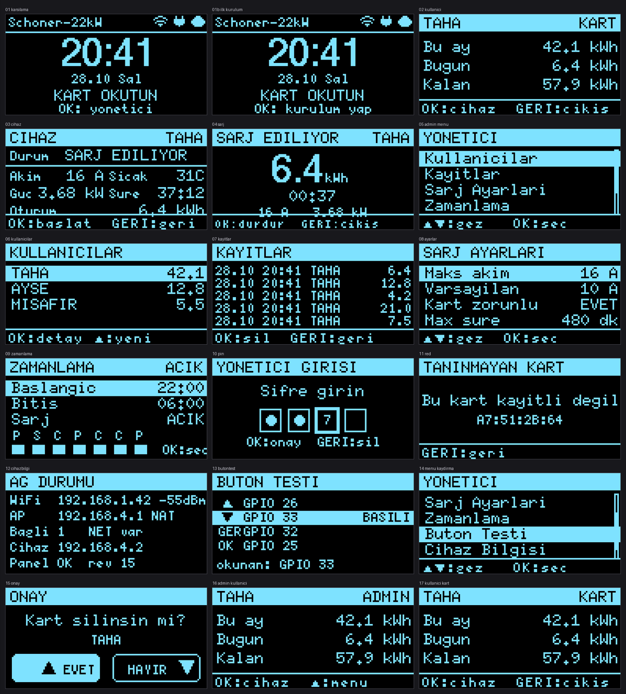

# ESP32 RFID Şarj Kontrolcüsü (Türkçe)

**Vitrinde satılan 22 kW AC şarj cihazını RFID kartla yetkilendirilen, kullanıcı
kotası tutan, bulut panelinden yönetilen ve 7/24 denetimsiz çalışan bir sisteme
çeviren uçtan uca proje.**

`ESP32-WROOM-32U` · `C++17 / PlatformIO` · `Tuya LAN v3.5` · `FastAPI + Postgres`



Şarj cihazının altındaki her şey bu projede üretildi: kontrolcü PCB, kutu,
firmware, LAN protokol sürücüsü ve yönetim paneli.

---

## Neden

Ev tipi 22 kW Tuya şarj cihazı **kimin** şarj ettiğini bilmez: tek hesap, tek
anahtar, kota yok, kayıt yok. Ortak kullanılan bir otoparkta elektrik faturası
bölüşülecekse bu yetersiz.

Cihaz ayrıca kapalı: tek arayüz üreticinin uygulaması, LAN protokolü belgesiz.
Cihazı değiştirmek yerine önüne; yetkilendirmeyi, ölçümü ve kaydı sahiplenen bir
kontrolcü koydum. Cihazın kendi güvenlik elektroniğine dokunulmadı.

```
                     ┌──────────────┐
┌──────────┐  Wi-Fi  ┌────────┐  TCP 6699  │  Şarj cihazı │
│  ESP32   │────────►│ Router │◄───────────│  (Tuya LAN)  │
│ + OLED   │         └────────┘  AES-GCM   └──────────────┘
│ + RC522  │              ▲
└────┬─────┘              │  ESP32 kendi AP'sini de açar ve cihazın
     │ HTTPS (dışa)       │  internet trafiğini NAT üzerinden geçirir
     ▼                    │
┌──────────────┐          │
│  Panel       │          │
│ FastAPI + PG │          │
│  Caddy + TLS │          │
└──────────────┘          │
   internete açık port yok
```

---

## Yetenekler

| Özellik | Nasıl |
|---|---|
| Kart yetkilendirme | RC522 UID okur; kart listesi NVS'de önbellekte, ağ yokken de çalışır |
| Kullanıcı kotası | Aylık/günlük kWh sayaçları NVS'de, oturum başlamadan denetlenir |
| Canlı şarj ekranı | Büyük kWh, süre, akım, güç, sıcaklık — Tuya DP push + 1 sn yoklama |
| Uzaktan kontrol | Panel şarjı başlatır/durdurur, akım sınırını yazar; cihaz sonraki senkronda uygular |
| Kayıt | Her oturum (başlangıç, bitiş, kWh, sebep kodu) NVS'ye ve Postgres'e yazılır |
| Çevrimdışı kuyruk | 32 oturum flash'ta bekler; tekil `client_id` sayesinde tekrar gönderim çift saymaz |
| Watchdog | Ayrı FreeRTOS görevi: loop 90 sn ilerlemezse, 10 dk Wi-Fi yoksa, heap < 15 KB ise yeniden başlatır |
| Ekran uykusu | 60 sn sonra OLED kapanır; şarj sürerken kapanmaz |
| Kartsız şarj kilidi | Cihaz kendi kendine başlarsa park moduna alınır, röle döngüye girmez |

---

## Zor kısımlar

### 1. Tuya LAN protokolünü çözmek

Cihaz TCP 6699 üzerinde Tuya LAN **v3.5** konuşuyor: 4 bayt başlık, 12 bayt nonce,
AES-128-GCM gövde, HMAC kuyruk. Şifrenin anahtarı (`local_key`) buluttan çıkmaz;
imzalı bulut API'sinden bir kez alınıp (`tuya/tuya_cloud.py`, yalnız stdlib,
HMAC-SHA256 imza) ESP32'ye **panelden TLS ile** veriliyor. Cihaz anahtarı yalnızca
RAM'de tutuyor; flash'a ve log'a yazmıyor.

DP numaraları protokolün parçası değil — cihazda keşfedilmesi gerekiyor. Aşağıdaki
harita, bulutun `spec` çıktısı ile canlı `status` karelerinin karşılaştırılmasıyla
fiziksel cihazda doğrulandı (`tuya/tuya_local.py identify`):

```
18 switch               bool   şarj aç/kapa              [yaz]
 4 charge_cur_set       int    A                          [yaz]
14 work_mode            enum   charge_now / charge_schedule
 3 work_state           enum   charger_free / charging / ...
10 power_total          int    kW x1000
 1 forward_energy_total int    kWh x100  (ömür boyu)
25 charge_energy_once   int    kWh x100  (bu oturum)
24 temp_current         int    °C
28 charge_time          int    dk x10
```

İki ayrıntı zaman kaybettirdi: büyük Integer DP'ler düz JSON sayısı değil
**base64** geliyor; cihaz ayrıca istenmeyen `0x08` push kareleri gönderiyor. Bu
yüzden sürücü kalıcı TCP oturumu tutup 1 Hz yokluyor, yalnız kopunca yeniden
bağlanıyor. Her yoklamada yeniden bağlanmak arayüzü saniyelerce geciktiriyordu.

### 2. Cihazın ağını sahiplenmek

Kontrolcü aynı anda STA + AP çalıştırıp NAPT açıyor; şarj cihazı
`EVCHARGE-SETUP` ağına katılıp buluta yine de ESP32 üzerinden çıkabiliyor:

```
1. STA router'a bağlanır, adres alır
2. softAP açılır                        (STA adresi olmadan çalışmaz)
3. NAPT açılır                          (1. adım olmadan başarısız)
4. softAP DHCP'si upstream DNS verir    (yoksa: "bağlı ama internet yok")
```

4. adım en sık atlanan: NAPT paketi yönlendirir ama DNS'i cevaplamaz; bu yüzden
AP'nin DHCP'si upstream bir çözümleyici duyurmak zorunda. Bu özellik
`arduino-esp32 >= 3.3.12` istiyor (PlatformIO `espressif32@8.0.0`) —
`WiFi.AP.enableNAPT()`; eski çekirdekler `CONFIG_LWIP_IPV4_NAPT`'ı derlemiyor.

### 3. Denetimsiz çalışmaya dayanmak

Cihaz garajda 7/24 açık, bu yüzden her bozulma türü ayrı ele alındı:

- **Wi-Fi koptu** — üstel geri çekilme (5, 10, sonra 20/30/60 sn), her 5. denemede
  radyo sıfırlama, bağlantıda NAPT ve DHCP DNS tazeleme, 10 dk sonra yeniden başlatma.
- **Cihaz cevap vermiyor** — yoklamalar arası 5→60 sn; 3 ardışık hata + 5 dk veri
  yoksa oturum son bilinen kWh ile kapatılır.
- **Şarj ortasında elektrik kesintisi** — kWh, kart UID ve başlangıç NVS'ye
  işlendiği için açılışta aynı oturum devam eder, şarj kaybolmaz.
- **İnternet koptu** — kayıtlar flash kuyruğunda bekler, 20 sn'de bir gönderilir;
  panel `client_id` ile mükerrer kaydı reddeder.
- **Yazılım kilitlendi** — sağlık görevi yeniden başlatır; sayı ve sebep NVS'de,
  `Yönetici → Sistem` ekranında görünür.
- **Panel düştü** — cihaz önbellekteki kart listesiyle **fail-closed** çalışır:
  yeni yetkilendirme yok, yeni oturum yok.

---

## Testler

| Takım | Adet | Komut | Kapsam |
|---|---|---|---|
| Firmware buton | 21 | `cd firmware/kart_sistem/sim && ./test.sh` | debounce, uzun bas, tekrar, durum makinesi |
| Firmware depolama | 26 | aynı komut | NVS kartlar, kota, kesinti kurtarma, 40 kayıtlık log |
| Panel uçtan uca | 30 | `cd panel && python test_e2e.py` (uygulama açık olmalı) | giriş, hız sınırı, kart CRUD, cihaz API, mükerrer kayıt, rev |

Firmware testleri gerçek `src/btn.cpp` ve `src/store.cpp` dosyalarını sahte Arduino
başlıklarıyla derliyor; dizüstünde bir saniyede koşuyor, kart gerekmiyor. Aynı
düzenek yukarıdaki 17 cihaz ekranını **gerçek** `src/ui.cpp` ile üretiyor — yani
görseller OLED'deki piksellerin aynısı.

Derleme büyüklüğü (`pio run`, espressif32 8.0.0 ile ölçüldü):

```
RAM:   16.7%  (54.804 / 327.680 bayt)
Flash: 41.8%  (1.313.878 / 3.145.728 bayt)
```

---

## Donanım

| Parça | Not |
|---|---|
| ESP32-WROOM-32U | harici anten — metal kutu içinde şart |
| M242 OLED 128x64 (SSD1309) | I2C, SCL=22 / SDA=21 |
| RC522 RFID okuyucu | SPI; CS=5, SCK=18, MOSI=23, MISO=19, RST=27 |
| 4 buton | 26 / 33 / 32 / 25 — `src/board.h` içinden değişir |
| Buck 12 V → 3.3 V | cihazın yardımcı beslemesinden |
| PCB 100x100 mm | tek yüz, 1:1 lehim şablonu `hardware/` içinde |
| 3B kutu | `hardware/box_pcb.scad`, `box_pcb_params.json`'dan üretilir |

Pin çakışmaları derleme zamanında yakalanıyor: aynı GPIO'ya iki buton ya da
I2C/SPI hattına buton atamak `#error` — sahada gizemli hata değil.

---

## Hızlı başlangıç

**Firmware**

```bash
cd firmware/kart_sistem
cp src/config.h.example src/config.h     # Wi-Fi + panel adresi + API token
pio run -t upload && pio device monitor
```

**Ekranları dizüstünde gör** (donanım gerekmez)

```bash
cd firmware/kart_sistem/sim && ./test.sh && ./build.sh
open out/ekranlar.png
```

**Panel, yerel**

```bash
cd panel
python3 -m venv .venv && .venv/bin/pip install -r requirements.txt
ADMIN_PASSWORD=dev-only-pass SESSION_SECRET=dev COOKIE_SECURE=0 \
  DATABASE_URL=sqlite:///./panel.db \
  .venv/bin/uvicorn app.main:app --port 8090
```

**Panel, VPS** — yer tutucular; repoda kişisel hiçbir değer yok

```bash
rsync -az panel/ root@<VPS_IP>:/opt/sarj-panel/
ssh root@<VPS_IP> 'bash /opt/sarj-panel/deploy/install.sh'
```

**Başka bir cihazda DP numaralarını bulmak**

```bash
cd tuya
python3 tuya_local.py raw        # cihazdan ham DP listesi
python3 tuya_local.py identify   # DP id'lerini bulut kodlarıyla eşleştir
```

---

## Dizinler

```
firmware/kart_sistem/     ana firmware — durum makinesi, UI, NVS, ağ
firmware/kart_sistem/sim/ Mac simülatörü: birim testleri + ekran üreteci
firmware/test/            donanım test sketch'leri (OLED, RC522, buton, NAPT)
panel/                    yönetim paneli — FastAPI, Postgres, Docker, Caddy, e2e
tuya/                     DP haritasını çıkarmak için bulut + LAN CLI'ları
docs/                     bağlantı şeması, pin haritası, montaj, plaket
hardware/                 3B kutu (SCAD/STL), PCB çizimi, 1:1 lehim şablonu
tools/                    kutu/PCB/şablon üreten Python betikleri
```

Firmware, panel, protokol araçları ve CAD üretimi toplamı ~11.5k satır C++/Python.

---

## Durum

| Parça | Durum |
|---|---|
| Donanım, kutu, PCB, lehim şablonu | tamam |
| OLED + RC522 + butonlar | fiziksel kartta test edildi |
| Firmware UI, durum makinesi, NVS | çalışıyor, temiz derleniyor |
| Elektrik kesintisi kurtarma | test edildi (26/26) |
| Tuya LAN v3.5 sürücüsü | gerçek cihazda çalışıyor; DP haritası cihazda doğrulandı |
| ESP32 ↔ panel senkronu (TLS, kuyruk) | çalışıyor; uzun süreli saha doğrulaması sürüyor |
| AP + NAPT | espressif32 8.0.0'da derleniyor; saha testi bekliyor |
| Kart sektörü imzası (klona karşı) | **yok** — yalnız UID, klonlanabilir |
| OTA güncelleme | **yok** — partition şeması `huge_app.csv` |
| Wi-Fi bilgisi / yönetici PIN'ini panelden yönetme | **yok** — derleme zamanında |

---

## Güvenlik notları

**Bilinçli olarak:**

- Panel internete **hiçbir** gelen port açmıyor; Caddy arkasında
  `127.0.0.1:8090` dinliyor. Postgres'in portu bile yok.
- ESP32 yalnızca dışa HTTPS çağrısı yapıyor (Bearer token); TLS, ISRG Root X1'e
  karşı doğrulanıyor — kapatılmıyor.
- `local_key` ve cihaz tokeni yalnız RAM'de; ikisi de log'a yazılmıyor.
- Giriş uygulama içinde hız sınırlı (5 hatalı deneme → IP başına 15 dk kilit);
  çerezler HttpOnly + Secure + SameSite=Lax.
- Konteynerler tüm yetkileri bırakıyor, `no-new-privileges`, bellek sınırlı.
- Sır dosyaları `.gitignore`'da (`config.h`, `.env`, `tuya/config.json`); repodaki
  örnekler yalnızca yer tutucu içeriyor.

**Bilinen sınırlar:**

- Mifare UID'leri klonlanabilir; kararlı bir kullanıcı kartı kopyalayabilir. Çözüm,
  kart sektörüne HMAC imzası yazmak — bu da bir anahtar yönetimi hikâyesi ister.
- Yönetici PIN'i derleme zamanında (`-D ADMIN_PIN=...`), arayüzden değiştirilemiyor.
- Tek yönetici hesabı var; çok kullanıcılı rol yok.
- Bu bir ürün değil, kişisel bir proje; Tuya veya herhangi bir şarj cihazı üreticisiyle
  bağlantılı değil. Geliştirmede kullanılan Tuya bulut kimliği kişisel bir IoT
  geliştirici hesabına ait.

---

## Sırada ne var

1. **Kimlik değil, gerçeklik doğrulaması** — (UID, sayaç) üzerine HMAC imzası,
   kuruluma özel anahtarla bir sektöre yazılsın; kart kopyalamak anahtar gerektirsin.
2. **Güven sınırını cihaza taşımak** — imzalı OTA ve A/B partition. Bugün firmware
   düzeltmesi garaja USB kabloyla gitmek demek.
3. **Cihaza güvenmek yerine onu denetlemek** — komut edilen durumla bildirilen
   `work_state` çelişirse pilot sinyalini kesen bir denetleyici. İki yerden
   sürülebilen bir cihazın hakeme ihtiyacı var.

---

## Lisans

MIT — [LICENSE](LICENSE) dosyasına bak.

English: [README.md](README.md)
